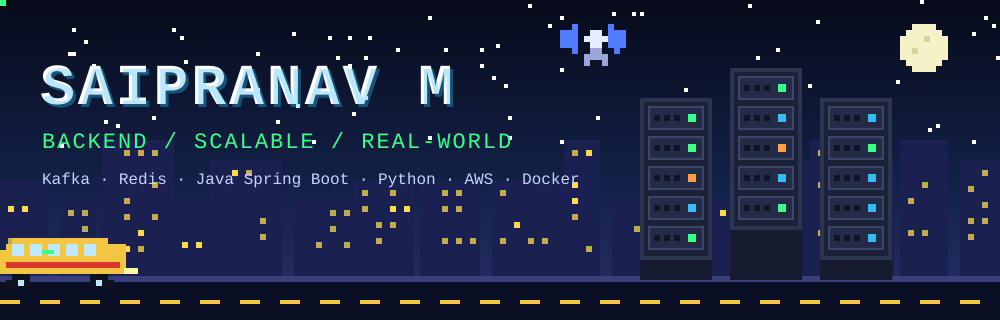
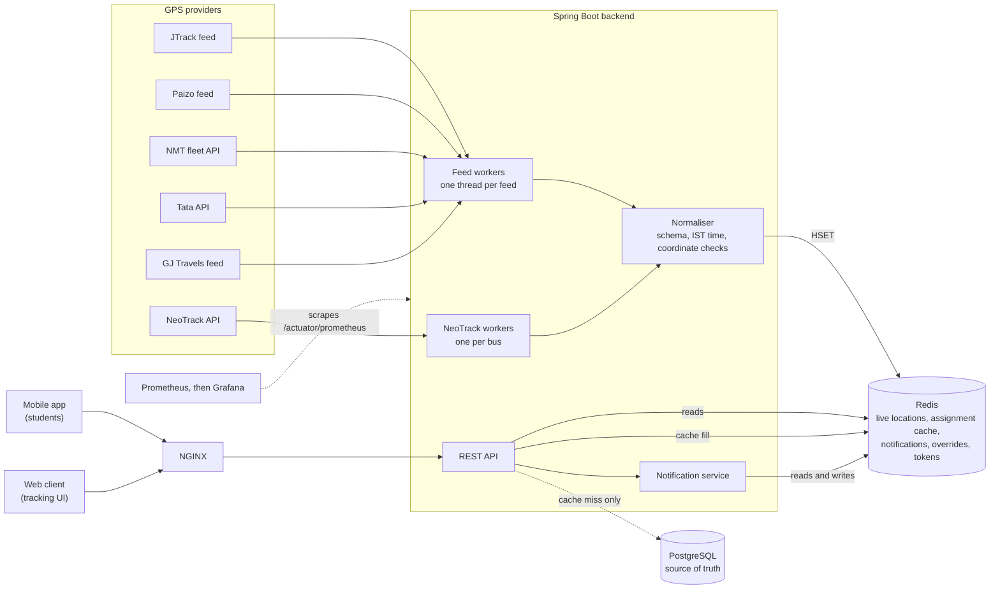
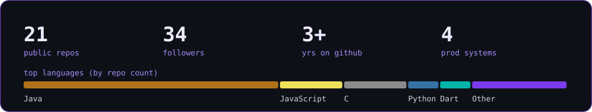

---

<div align="center">


</div>
<div align="center">

<!--  -->

<a href="https://github.com/AvGeeky">
  
</a>

<br/>

<a href="https://www.linkedin.com/in/saipranav-m/"></a>
<a href="mailto:sai.saip2005@gmail.com"></a>
<a href="https://drive.google.com/file/d/1ZIh0Wfvmlf-RY3_MEJmrkvA8kn-d52zm/view?usp=sharing"></a>
<a href="http://bustracker.snuchennai.edu.in/"></a>

<a href="https://github.com/AvGeeky?tab=repositories"></a>
<a href="https://github.com/AvGeeky?tab=repositories"></a>
<br/><br/>

<!-- 
 -->

</div>

## About me

I'm a **B.E. Computer Science** student at **SSN College of Engineering, Chennai** (CGPA 8.47) who likes building backends that actually get used. Several of my systems run in production for thousands of students at **SSN** and **Shiv Nadar University Chennai**, and I'm usually involved in the whole thing, from system design through to deployment and monitoring.

```java
public class Saipranav {
    String role      = "Ex-SDE Intern @ Barclays (Jun-Jul 2026)";
    String studying  = "B.E. CSE, SSN College of Engineering (2023-2027)";
    String obsessed  = "latency, correctness, idempotency, observability";
    String[] learning = { "Kubernetes", "Distributed systems", "Cloud infra" };
    String funFact   = "Loves aviation!";
}
```

## Experience

| | Role | What I did |
|---|---|---|
| 🏦 | **Former SDE Intern, Barclays** <br/>*Pune · Jun-Jul 2026* | Rebuilt a legacy dataset-comparison tool as a **distributed AWS Glue / PySpark** framework: **92% faster** (1.5 hrs to 7 min on 10M+ rows × 700+ columns). Supports Iceberg and Hive, schema-drift detection, parallel chunked-column processing, and a synthetic data generator. |
| ⚙️ | **Full Stack Engineering Intern, Dexio LabX** <br/>*Chennai · Oct 2025-Feb 2026* | Built an **event-driven async job pipeline** (FastAPI, Redis lists, AsyncIO) with idempotent handling, exponential-backoff retries and **dead-letter-queue** routing for poison-pill tasks. Streamed ingestion for large LLM inputs. |

---

## Featured projects

### 🚌 Real-Time Bus Tracking Platform
**Production system for SSN College & SNU Chennai** · [🔴 Live](http://bustracker.snuchennai.edu.in/) · [Code](https://github.com/AvGeeky/SSN_SNUC_Bus_Assignment_Tracking_BackEnd)

> Live transport tracking for **3,000+ users across 2 universities**, with **<500ms p90 API latency** under a 100-concurrent-user ramped load test.

- Concurrent GPS ingestion from **~24 independantly polled heterogeneous vendor APIs**, one thread per vendor with time-of-day adaptive polling, so one slow vendor never cascades
- **Redis Hashes** state store with last-timestamp-wins semantics; **no database on the hot path**
- Redis transactions and pipelining for multi-key updates and batched reads
- Admin dashboard: fleet monitoring, breakdown handling, hot-swappable route allocation, broadcast/targeted notifications, RBAC
- Fully **on-prem**: NGINX, Docker Compose, Prometheus, Grafana and Loki with automated alerts



`Java` `Spring Boot` `Redis` `PostgreSQL` `Docker` `NGINX` `Prometheus` `Grafana`

---

### Payment Pipelines for Invente (SSN's tech fest)

| | **Kafka Payment Pipeline (2025)** | **Redis Payment Pipeline (2026)** |
|---|---|---|
| Scale | **3,000+ transactions** at the fest | k6 load test: **1,000 req/s at 517ms p95, 0% failures** over 100K+ requests |
| Core idea | Transactional Outbox producers + **Kafka Streams windowed joins** to reconcile payments with settlement receipts | Transactional Outbox on Postgres (`FOR UPDATE SKIP LOCKED`) feeding **Redis Streams** consumer groups |
| Reliability | Handles out-of-window events; ceiling validated at **50,000+ events/min** | XCLAIM sweeper threads, dead-letter queues, idempotent processing |
| Ops | Prometheus, Grafana, NGINX-fronted VPS | NGINX gateway, SSL, Prometheus/Grafana/Loki, Cloudflare |
| Code | [kpaymentpipeline](https://github.com/AvGeeky/kpaymentpipeline_invente2025PaymentSystem) | [SSNInventePaymentSystem_Backend2026](https://github.com/AvGeeky/SSNInventePaymentSystem_Backend2026) |

```mermaid
flowchart LR

    Client["External Client (This Repo)"]
    InternalClient["Internal Client not a part of this repo(Admin)"]

    subgraph Edge["Edge / Gateway"]
        Nginx["Nginx Reverse Proxy<br/>(SSL, CORS, Rate Limit)"]
    end

    subgraph API["API Layer"]
        ExternalController["ExternalController<br/>(Port 8080)<br/>Payment System Backend - This repo"]
        AdminAPI["Admin Backend - Not this Repo <br/>(Port 4000)"]
    end

    subgraph Services["Service Layer"]
        ExternalService["ExternalControllerReceiverService"]
    end

    subgraph Persistence["Persistence Layer"]
        MyBatisMappers["MyBatis Mappers"]
        PostgreSQL[("PostgreSQL")]
    end

    Client -->|HTTPS /api/| Nginx
    InternalClient -->|HTTPS /fileapi/| Nginx

    Nginx -->|Proxy Pass| ExternalController
    Nginx -->|Proxy Pass - Strip fileapi prefix| AdminAPI

    ExternalController --> ExternalService
    ExternalService --> MyBatisMappers
    AdminAPI --> PostgreSQL
    MyBatisMappers --> PostgreSQL

    subgraph Async["Asynchronous Email Pipeline"]
        VerifPoller["PaymentVerificationPoller<br/>@Async verificationPollerExecutor"]
        ReminderPoller["ReminderEmailPoller<br/>@Async reminderPollerExecutor"]
        RejectionPoller["RejectionEmailPoller<br/>@Async rejectionPollerExecutor"]
        RedisStream[("Redis Stream<br/>invente:payments:verified_stream")]
        Worker["PaymentEmailWorker<br/>StreamListener"]
        Sweeper["PaymentStreamSweeper<br/>(Poison Pill Protection)"]
        EmailService["TicketEmailSenderService"]
    end

    PostgreSQL --> VerifPoller
    PostgreSQL --> ReminderPoller
    PostgreSQL --> RejectionPoller

    VerifPoller --> RedisStream
    ReminderPoller --> RedisStream
    RejectionPoller --> RedisStream

    RedisStream --> Worker
    Sweeper --> RedisStream
    Sweeper --> Worker

    Worker --> MyBatisMappers
    Worker --> EmailService

    EmailService --> SMTP[("SMTP")]

```


---

### AttendEz: secure multi-mode attendance
**Deployed at SSN College** · 🥈 *2nd Place, Encender 3.0 Project Expo 2026* · [Code](https://github.com/AvGeeky/AttendanceSystemBE) · [Demo ▶](https://www.youtube.com/watch?v=YFHxfV337GY)

- Three modes: manual, one-time codes, **time-rotating QR**
- **HMAC-SHA256** verification with per-user, device-bound secrets, plus biometric-gated auth
- Redis-backed ephemeral QR state with **sub-millisecond** server-side verification
- Cut manual verification overhead by **95%**; **200+ concurrent submissions** in production

`Java` `Spring Boot` `Redis` `MongoDB` `Docker` `NGINX` `JUnit` `Jenkins`

---

### SecUrVote: cryptographically verifiable voting
🥇 *1st Place, Encender 2.0 Project Expo 2025* · [Backend](https://github.com/AvGeeky/SecUrVote_BE) · [Frontend](https://github.com/AvGeeky/SecUrVote_Frontend) · [Site](https://securvote.vercel.app) · [Demo ▶](https://youtu.be/4nAzh8N8cbA)

RSA vote encryption, HMAC-secured Magic IDs for uniqueness, PBKDF2 auth with OTP login, and an immutable blockchain-style ledger with public verification.

### InterVueX: AI-powered hiring
🥇 *1st Place, InnovateX National Hackathon (100+ teams)* · [Backend](https://github.com/AvGeeky/InterVueX-Backend)

Resume- and rubric-driven question generation, live coding via Judge0, face detection, audio processing and sentiment analysis.

### PeerLearn: peer-to-peer learning
Built in **24 hours** at Envision SSN · [Backend](https://github.com/AvGeeky/PeerLearn_Backend)

Gamified "Stars" currency, community roadmaps, and dynamic teacher/learner roles.

<details>
<summary><b>🧩 More projects</b></summary>

<br/>

- 🔑 [Simple Password Manager](https://github.com/AvGeeky/simplePasswordManager_SoftwareSecurityAssignment): Java, software security coursework
- 🚆 [Railway Reservation System](https://github.com/AvGeeky/Railway_Reservation_CLangProject): C, booking, PNR status, cancellation
- 🧍 [P-DaISy](https://github.com/AvGeeky/csproject-P-DaISy): police database and facial-recognition identification (high school project)
- 🩺 [healthbusters](https://github.com/AvGeeky/healthbusters): Dart / Flutter
- 🎮 [QGameRepo](https://github.com/AvGeeky/QGameRepo): Godot game for the FAI lab
- 🧠 [ML Lab](https://github.com/AvGeeky/ML_Lab_Sai) · ⚙️ [Compiler Design Lab](https://github.com/AvGeeky/CompilerDesignLab)

</details>

---

## 🛠️ Tech stack

<div align="center">

**Languages**<br/>
<br/>
**Backend & data**<br/>
<br/>
**Cloud & DevOps**<br/>
<br/>
**Frontend & tools**<br/>


</div>

**Also:** PySpark · AWS Glue/Athena/Lake Formation · Kafka Streams · Redis Streams · k6 · JUnit

---

## 🏆 Achievements

- 🥇 **1st**, InnovateX National Hackathon, 100+ teams (InterVueX)
- 🥇 **1st**, Encender 2.0 Project Expo 2025 (SecUrVote)
- 🥈 **2nd**, Encender 3.0 Project Expo 2026 (AttendEz)

## 👥 Leadership

- **Vice Chairperson**, ACM Chapter SSN (Jul 2026-Present)
- **Lead, Full Stack Development**, SSN Coding Club (Sep 2026-Present)
- **Deputy Head (Technical)**, ACM Chapter SSN (2025-2026)
- **Placement Committee Member**, SSN College of Engineering

## 📚 Research

- **CLEF 2024 (JOKER Lab):** genre classification of humorous text with transformer and traditional ML models
- **ILSUM 2024:** multilingual text summarisation with T5 and Gemini 1.0 Pro

---

---

<div align="center">

**Open to SDE / backend opportunities, so feel free to reach out.**


</div>

## At a glance

<div align="center">



<br/>

</div>


<div align="center">


</div>
